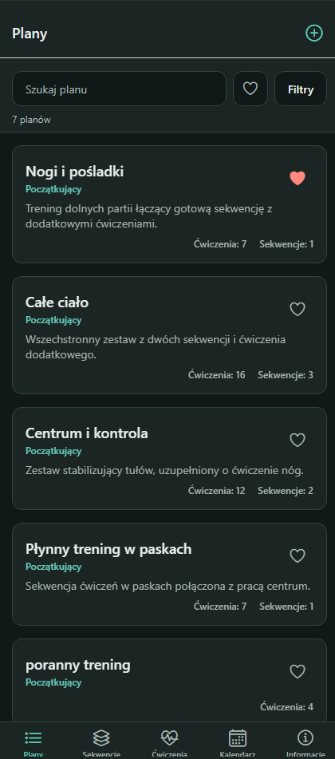
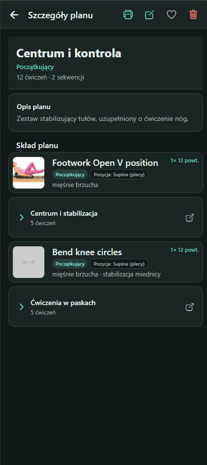
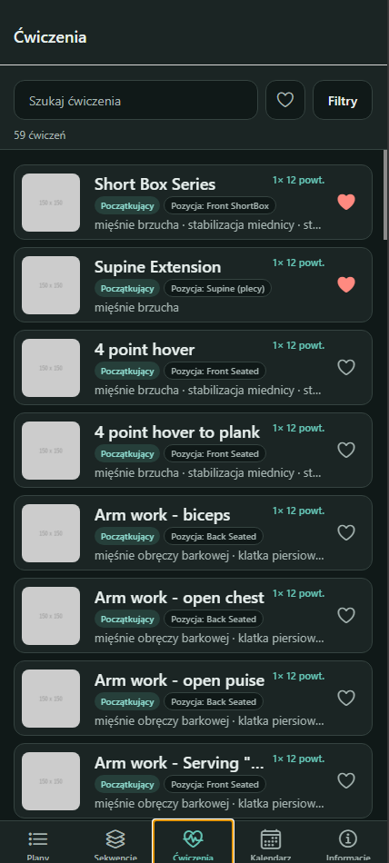
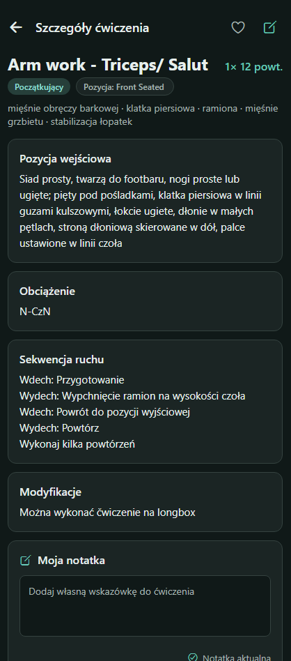
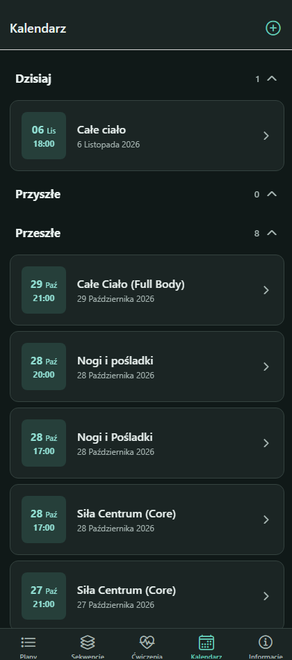
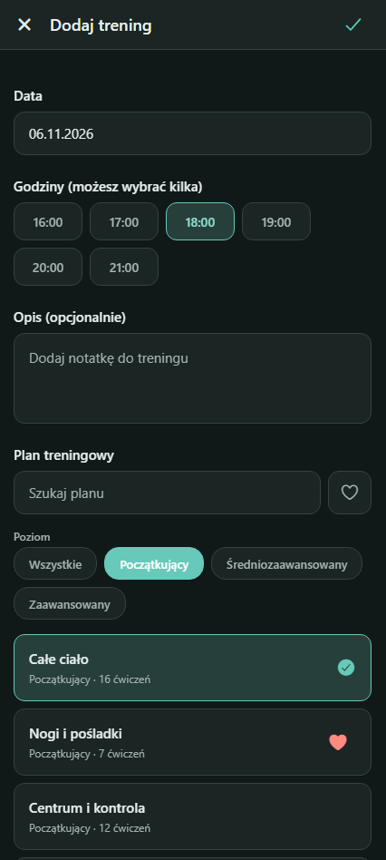
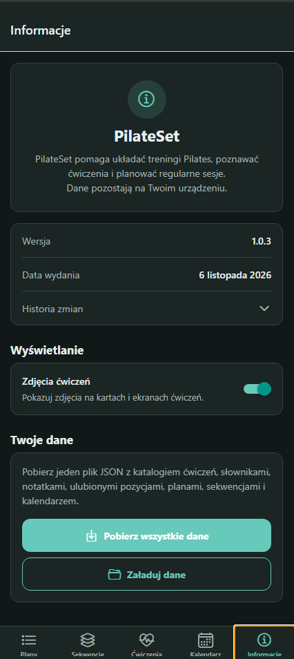

<div align="center">

# PilateSet

**Offline-first Pilates companion: exercise library, reusable plans, sequences and a workout calendar — all stored on your device.**


</div>

## Contents

- [Features](#features)
- [App tour](#app-tour)
- [Tech stack](#tech-stack)
- [Getting started](#getting-started)
- [Building an installable app](#building-an-installable-app)
- [Testing](#testing)
- [Code quality](#code-quality)
- [Project structure](#project-structure)
- [Data and backups](#data-and-backups)

## Features

| Tab             | What you can do                                                                                                                                     |
| --------------- | --------------------------------------------------------------------------------------------------------------------------------------------------- |
| **Plans**       | Build, edit, reorder, favorite and print routines made of exercises and sequences.                                                                  |
| **Sequences**   | Group exercises into short flows and reuse them inside plans.                                                                                       |
| **Exercises**   | Search and filter by level, position and body area; read the description, starting position and modifications; add a personal note; mark favorites. |
| **Calendar**    | Schedule a plan for a day and hour; review today's, upcoming and past workouts.                                                                     |
| **Information** | App version and changelog, exercise-photo toggle, export and import of all data as one JSON file.                                                   |

Also: works fully **offline**, follows the device's **light/dark** appearance (screenshots below use dark mode), and runs on Android, iOS and web.

## App tour

<table>
  <tr>
    <td align="center"><br /><b>Plans</b><br />Favorites, search and filters</td>
    <td align="center"><br /><b>Plan details</b><br />Contents, edit, print, favorite</td>
    <td align="center"><br /><b>Exercises</b><br />Library with photos and filters</td>
    <td align="center"><br /><b>Exercise details</b><br />Description, modifications, personal note</td>
  </tr>
  <tr>
    <td align="center"><br /><b>Calendar</b><br />Today, upcoming and past workouts</td>
    <td align="center"><br /><b>Add workout</b><br />Date, hours, note and plan picker</td>
    <td align="center"><br /><b>Information</b><br />Version, changelog, JSON backup</td>
  </tr>
</table>

## Tech stack

| Area              | Libraries                                                                                                                |
| ----------------- | ------------------------------------------------------------------------------------------------------------------------ |
| Framework         | [Expo](https://docs.expo.dev) SDK 58, [React Native](https://reactnative.dev) 0.88, React 19, TypeScript                 |
| Navigation        | [Expo Router](https://docs.expo.dev/router/introduction/) — file-based routes in `app/`                                  |
| Storage           | `expo-file-system` (JSON files on device), `@react-native-async-storage/async-storage` (web and preferences)             |
| Files and sharing | `expo-document-picker`, `expo-sharing`, `expo-print`, `pdfmake` (PDF on web)                                             |
| Gestures          | `react-native-gesture-handler`, `react-native-reanimated`, `react-native-draggable-flatlist`                             |
| UI                | `@expo/vector-icons`, `@react-native-community/datetimepicker`, `react-native-safe-area-context`, `react-native-screens` |
| Testing           | Jest + `jest-expo`, `@testing-library/react-native`, [Maestro](https://docs.maestro.dev)                                 |
| Tooling           | ESLint (`eslint-config-expo`), Prettier, EAS Build                                                                       |

## Getting started

**Requirements:** [Node.js](https://nodejs.org) LTS and npm. On a physical device install **Expo Go** (or a development build).

```bash
npm install
npm start            # = npx expo start
```

| Command           | Purpose                               |
| ----------------- | ------------------------------------- |
| `npm run android` | Open on an Android emulator or device |
| `npm run ios`     | Open on an iOS simulator (macOS only) |
| `npm run web`     | Run in the browser                    |

### Tunnel mode (ngrok)

When the phone and computer are not on the same network, expose Metro through a tunnel:

```bash
npx expo start --tunnel ngrok      # or: npm run start:tunnel
```

Accept the prompt to install `@expo/ngrok` on first run, then scan the QR code with Expo Go (Android) or the Camera app (iOS). Tunnel mode is slower than LAN, so use plain `npx expo start` when both devices share a network.

> Libraries with native code outside Expo Go need a [development build](https://docs.expo.dev/develop/development-builds/introduction/): `npx expo run:android`, `npx expo run:ios` or `eas build --profile development`.

## Building an installable app

Builds run in the cloud with [EAS Build](https://docs.expo.dev/build/introduction/). Profiles live in [`eas.json`](eas.json); the application id (`com.vennnx.pilateset`) is set in [`app.json`](app.json).

```bash
npm install --global eas-cli
eas login
```

| Goal                            | Command                                             | Output                           |
| ------------------------------- | --------------------------------------------------- | -------------------------------- |
| Android APK to install directly | `eas build --platform android --profile preview`    | `.apk`                           |
| Android bundle for Google Play  | `eas build --platform android --profile production` | `.aab`                           |
| iOS for TestFlight / App Store  | `eas build --platform ios --profile production`     | `.ipa` (Apple Developer account) |
| iOS for registered devices      | `eas build --platform ios --profile preview`        | ad-hoc `.ipa`                    |

Download the `.apk` from the link EAS prints (or the Expo dashboard), copy it to the phone and open it, allowing installs from unknown sources. Publish store builds with `eas submit --platform android|ios`.

### Local Android build (no EAS, no account)

The result is a single `app-release.apk` that you can copy to a phone and install.

**1. Prerequisites**

| Tool                                                       | Notes                                                                                                |
| ---------------------------------------------------------- | ---------------------------------------------------------------------------------------------------- |
| Node.js LTS + `npm install`                                | Already needed to run the app                                                                        |
| **JDK 17 or 21** (a full JDK with `javac`, not just a JRE) | Check with `javac -version`. Temurin works well.                                                     |
| **Android SDK**                                            | Android Studio, or only the [command-line tools](https://developer.android.com/studio#command-tools) |

With command-line tools only (Linux / WSL), install the packages the project needs (versions come from `node_modules/react-native/gradle/libs.versions.toml`):

```bash
export ANDROID_HOME=$HOME/Android/Sdk
sdkmanager --licenses
sdkmanager "platform-tools" "platforms;android-36" "platforms;android-37.0" \
           "build-tools;36.0.0" "build-tools;37.0.0" "ndk;27.1.12297006"
```

Environment variables (add to `~/.bashrc` or `~/.zshrc`):

```bash
export JAVA_HOME=/path/to/jdk
export ANDROID_HOME=$HOME/Android/Sdk
export PATH=$JAVA_HOME/bin:$ANDROID_HOME/platform-tools:$PATH
```

Run `npx expo-doctor` to verify the setup.

**2. Build**

```bash
npx expo prebuild --platform android      # generates android/ (git-ignored)
cd android
./gradlew assembleRelease
```

The first build takes around 10 minutes. The APK is written to `android/app/build/outputs/apk/release/app-release.apk`. If Gradle reports that the toolchain "does not provide the required capabilities: JAVA_COMPILER", you have a JRE only; install a full JDK and point `JAVA_HOME` at it.

**3. Install on a phone**

- Copy the `.apk` to the phone (USB cable, cloud drive, Bluetooth), open it and allow installs from unknown sources, **or**
- with a USB-connected phone and USB debugging enabled: `adb install -r android/app/build/outputs/apk/release/app-release.apk`. In WSL, `adb` cannot see USB devices, so copy the file instead.

`npx expo run:android --variant release` does steps 2 and 3 in one go when a device or emulator is connected.

**4. Rebuilding after changes**

| Change                                                                | What to do                                                                       |
| --------------------------------------------------------------------- | -------------------------------------------------------------------------------- |
| JS / TypeScript / assets only                                         | `cd android && ./gradlew assembleRelease`                                        |
| `app.json` (name, icon, package id, plugins) or new native dependency | `npx expo prebuild --platform android --clean`, then `./gradlew assembleRelease` |
| New release for existing installs                                     | Increase `android.versionCode` in `app.json` (and `version`), then rebuild       |

**Good to know**

- The local APK is signed with a debug key: fine for your own devices, not for Google Play (use EAS or your own keystore).
- Update by installing the new APK over the old one. It must have the same application id and signing key; otherwise uninstall first, which **deletes app data**, so export a JSON backup from the Information tab beforehand.
- Changing `android.package` in `app.json` creates a different app that installs side by side with the old one.
- iOS local builds require macOS and Xcode: `npx expo prebuild --platform ios`, then `npx expo run:ios --device --configuration Release`.

**Release checklist:** bump `version` in `app.json` and `package.json`, and add an entry to `data/appInfo.json`.

## Testing

Tests live in `tests/` and use shared fixtures from `tests/fixtures/`, so they do not depend on the bundled catalog.

| Level                       | Location                      | Command                   |
| --------------------------- | ----------------------------- | ------------------------- |
| Unit and storage logic      | `tests/unit`, `tests/storage` | `npm run test:unit`       |
| Components (one file each)  | `tests/components`            | `npm run test:components` |
| Screens (one file per view) | `tests/screens`               | `npm run test:screens`    |
| End-to-end (Maestro)        | `.maestro`                    | `npm run test:e2e`        |

```bash
npm test                 # unit + component + screen tests
npm run test:watch       # watch mode
npx jest --coverage      # coverage report
```

End-to-end flows need [Maestro](https://docs.maestro.dev/getting-started/installing-maestro) and the app installed on an emulator or simulator (for example `npx expo run:android` or a `preview` build). Flows start from a clean state; shared steps are in `.maestro/helpers/`.

## Code quality

```bash
npm run lint             # expo lint + eslint tests
npm run typecheck        # tsc --noEmit
npm run format           # prettier --write .
npm run format:check     # prettier --check .
```

## Project structure

```text
app/          Expo Router screens (tabs, plan, sequence, exercise, calendar)
components/   Reusable UI components
constants/    Storage, domain logic, hooks, theme, platform-specific helpers
data/         Bundled JSON: exercises, taxonomy, app info, initial plans/calendar
assets/       Icons, splash, exercise photos
docs/         Documentation assets (docs/screenshots)
tests/        Unit, storage, component and screen tests, plus fixtures
.maestro/     End-to-end flows
```

## Data and backups

The JSON files in `data/` are bundled with the app and provide its initial content; an installed app cannot modify them. At runtime:

- **Android / iOS:** plans are saved in `plans.json` and calendar entries in `calendar.json` under the app's documents directory. Android keeps them private to the app; on iOS the Documents folder is visible in the Files app. The create forms show the exact location.
- **Web:** live data is kept in browser storage under `pilateset.plans.v1` and `pilateset.calendar.v1`.

**Export / import.** The Information tab exports reference data, private exercise notes, favorites, plans and calendar as one JSON file. Each plan's `content` array stores `{ "type": "exercise" | "sequence", "id": "..." }` entries in display order. Use **Load data** to restore a file; importing replaces the saved data included in the backup. On Android and iOS pick a destination from the system share sheet; on web the file downloads in the browser.

**Model notes.** Each exercise has a difficulty level (`data/exerciseLevels.json`) and one or more body areas (`data/bodyAreas.json`). Plans have no categories of their own — their body areas derive from their exercises. Stored plans and calendar entries are normalized when loaded.

**Appearance.** The app follows the device's light or dark theme. After changing appearance or iOS document settings in the configuration, rebuild the native app.
